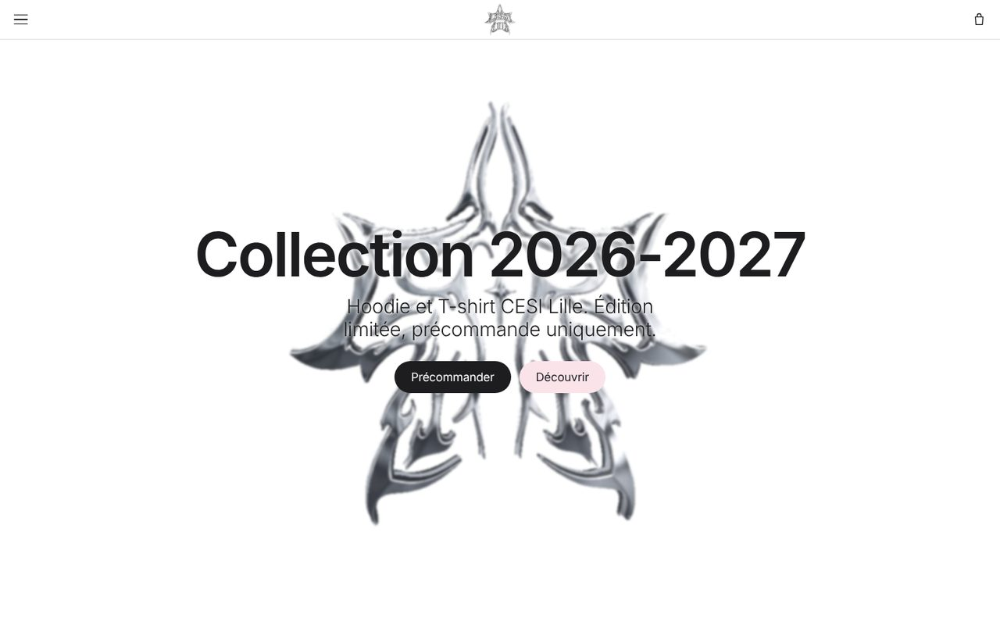
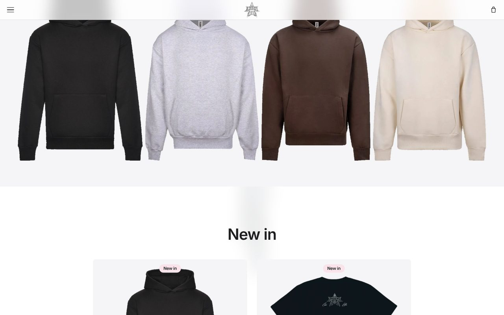
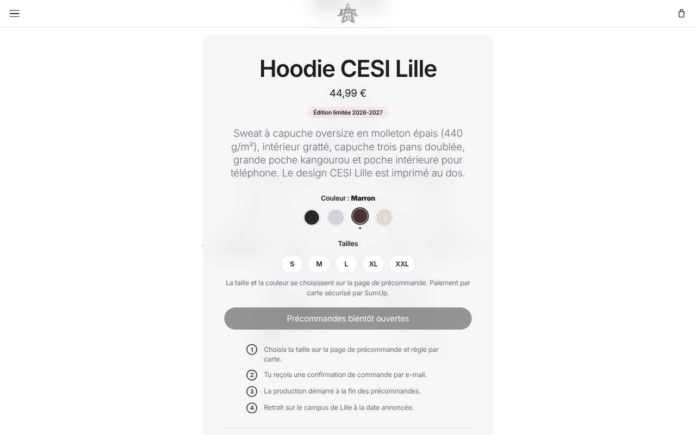
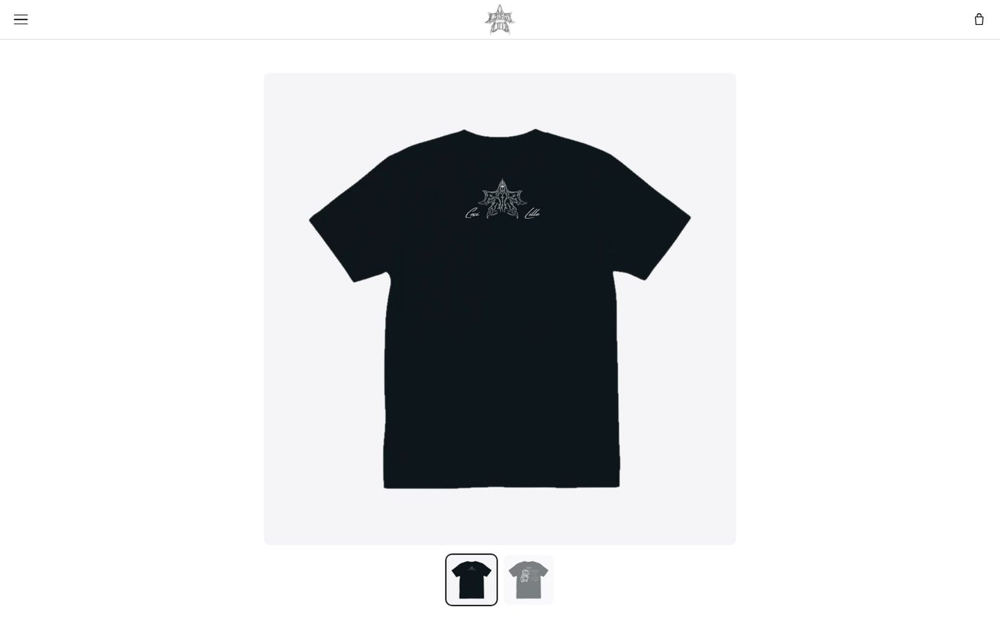
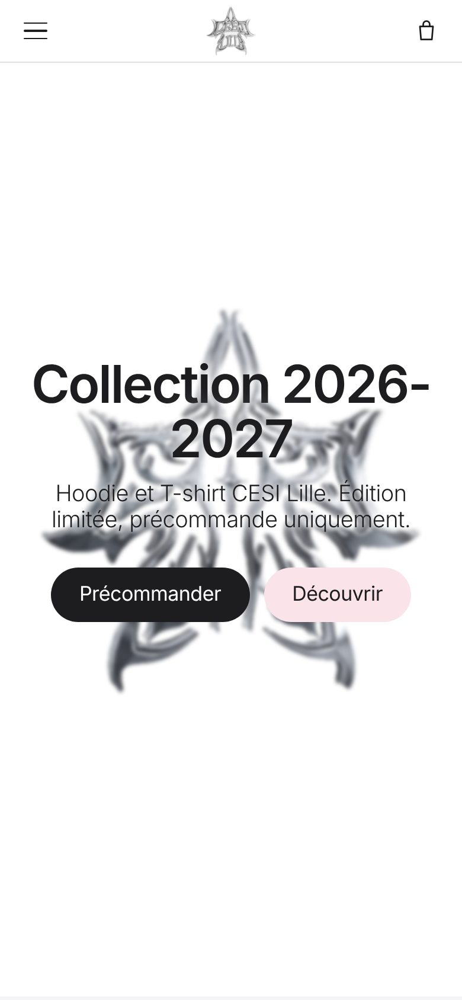
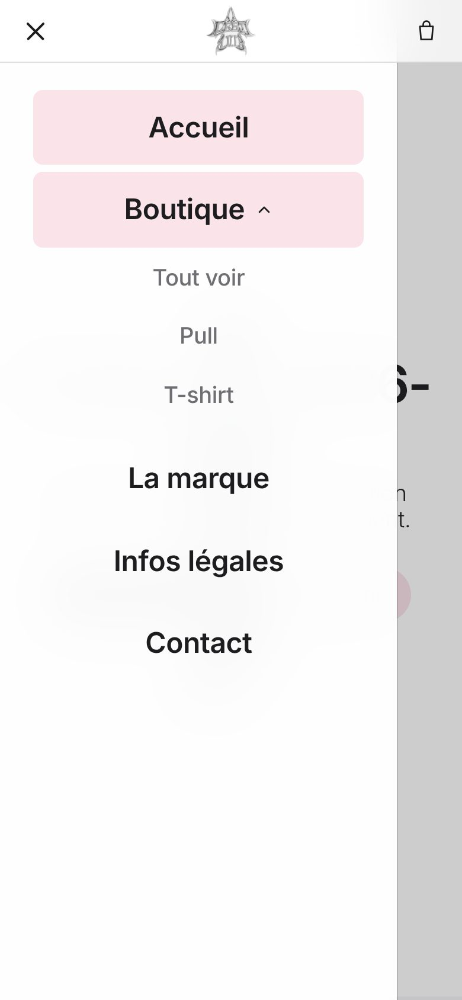

<div align="center">


# BDE CESI Lille · Boutique

**Site vitrine et précommandes du merch CESI Lille : hoodie et T-shirt, en édition limitée.**


</div>

---

## Aperçu

<table>
  <tr>
    <td width="50%"><br><sub><b>Accueil</b> · logo chromé qui tourne en 3D derrière un verre dépoli</sub></td>
    <td width="50%"><br><sub><b>Nouveautés</b> · le hoodie en quatre coloris et le T-shirt</sub></td>
  </tr>
  <tr>
    <td width="50%"><br><sub><b>Page hoodie</b> · choix du coloris, tailles, guide des tailles</sub></td>
    <td width="50%"><br><sub><b>Page T-shirt</b> · devant et dos</sub></td>
  </tr>
</table>

<p align="center">
  
  &nbsp;&nbsp;
  
</p>

## Ce que fait le site

- **Vitrine et précommande** : le site présente les produits, la commande et le paiement par carte se font sur la boutique en ligne **SumUp**. Aucune donnée bancaire ne passe par le site.
- **Catalogue piloté par un seul fichier** : produits, prix, coloris, images et tailles se règlent dans [`assets/js/products.js`](assets/js/products.js). Les pages se génèrent à partir de là.
- **Pages de vente** : une par produit (`hoodie.html`, `tshirt.html`), plus une page `boutique.html` qui liste tout.
- **Logo chromé en 3D** (WebGL) qui tourne en fond, avec repli sur une image fixe si WebGL est absent ou si l'utilisateur demande moins d'animations.
- **Responsive** : pensé mobile d'abord, menu burger avec sous-menu Boutique.
- **Sobre et rapide** : HTML, CSS et JavaScript simples, aucune dépendance, aucun cookie, aucun outil de suivi.
- **Sécurisé** : politique de sécurité de contenu (CSP) et en-têtes dans [`_headers`](_headers), liens de paiement acceptés uniquement en `https`.
- **Accessible** : navigation au clavier, lien d'évitement, attributs ARIA, respect de `prefers-reduced-motion`.

## Structure du dépôt

```text
.
├── index.html               Accueil
├── boutique.html            Liste des produits
├── hoodie.html              Page de vente du hoodie
├── tshirt.html              Page de vente du T-shirt
├── infos-legales.html       Mentions légales, conditions de vente, confidentialité
├── 404.html                 Page d'erreur
├── assets/
│   ├── css/style.css        Feuille de style unique
│   ├── js/
│   │   ├── products.js      Réglages de la boutique et catalogue (le fichier à modifier)
│   │   ├── app.js           Affichage du catalogue, pages produit, lightbox, inscription
│   │   ├── menu.js          Menu burger et sous-menu Boutique
│   │   ├── logo3d.js        Logo chromé 3D (WebGL)
│   │   └── logo-tex.js      Texture du logo intégrée (repli pour l'ouverture directe du fichier)
│   └── images/
│       ├── brand/           Logos et favicon
│       ├── banners/         Bannières de l'accueil
│       ├── products/        Visuels produits (hoodie/, tshirt/, avec leurs miniatures thumbs/)
│       └── social/          Image de partage (réseaux sociaux)
├── design/print/            Fichiers d'impression du design au dos du hoodie
├── docs/
│   ├── guide-mise-en-ligne.md   Guide complet : SumUp, domaine, déploiement, tests
│   └── screenshots/             Captures utilisées dans ce README
├── _headers                 En-têtes de sécurité et de cache (Netlify)
├── netlify.toml             Réglages Netlify
└── robots.txt
```

## Démarrer en local

Aucune installation : il suffit de servir le dossier.

```bash
python3 -m http.server 8000
# puis ouvrir http://localhost:8000
```

Ouvrir `index.html` directement dans le navigateur fonctionne aussi.

## Configurer la boutique

Tout se passe dans [`assets/js/products.js`](assets/js/products.js) :

| Réglage | Rôle |
| --- | --- |
| `shopUrl` | Adresse de la boutique SumUp (`https://…`). Tant qu'elle est vide, les boutons affichent « Précommandes bientôt ouvertes ». |
| `contactEmail` | Adresse de contact du BDE. |
| `preorderEnd` | Date de fin des précommandes (`"2026-12-15"`), les boutons se désactivent ensuite. |
| `PRODUCTS` | Les produits : nom, prix, tailles, coloris et images. |

Ajouter un coloris ou un produit : copier un bloc existant de `PRODUCTS`, déposer les images dans `assets/images/products/` et renseigner leurs chemins. Le détail pas à pas est dans le [guide de mise en ligne](docs/guide-mise-en-ligne.md).

## Mettre en ligne

- **Netlify (conseillé, fonctionne avec un dépôt privé)** : *Add new site → Import an existing project → GitHub*, choisir ce dépôt, laisser la commande de build vide et déployer. Chaque `git push` sur `main` met le site à jour.
- **GitHub Pages** : *Settings → Pages → Deploy from a branch → `main` / root*. Sur un compte gratuit, le dépôt doit être public.

Nom de domaine, tests avant ouverture et configuration de SumUp : voir le [guide](docs/guide-mise-en-ligne.md).

## Avant l'ouverture

- [ ] Renseigner `shopUrl` (boutique SumUp)
- [ ] Renseigner le prix du T-shirt (`price` dans `products.js`)
- [ ] Compléter les passages entre crochets de `infos-legales.html`
- [ ] Remplacer les liens Instagram et TikTok du pied de page
- [ ] Faire une commande test avec une vraie carte, puis la rembourser

## Contact

BDE CESI Lille · [bde-lille@viacesi.fr](mailto:bde-lille@viacesi.fr)
